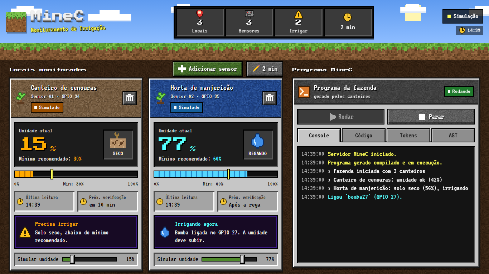

# 🌱 Protótipo MineC: irrigação com ESP32

Front-end, back-end e firmware do protótipo da plantação automática. Tudo o que a fazenda faz está escrito em **MineC**: o painel gera um programa MineC, o servidor compila (léxico, sintático e **semântico**) e executa com um **interpretador**, e o ESP32 lê o sensor e liga a bomba.



```
 Celular / PC                Servidor (Python)                       ESP32
┌────────────┐  HTTP   ┌──────────────────────────────┐  Wi-Fi  ┌────────────────┐
│  Painel    │ ──────▶ │ gerador ▶ compilador MineC   │ ◀─────▶ │ sensor GPIO 34 │
│  (web/)    │ ◀────── │ (léxico ▶ sintático ▶        │  0,5 s  │ relé   GPIO 26 │
└────────────┘         │  semântico) ▶ interpretador  │         └────────────────┘
                       └──────────────────────────────┘
```

| Instrução MineC | O que acontece no protótipo |
|---|---|
| `observer umidade = 34` | sensor capacitivo ligado no GPIO 34 |
| `lever bomba = 26` | relé da bomba ligado no GPIO 26 |
| `mine umidade` | pede uma leitura nova ao ESP32 e converte para % (0 a 100). Sem leitura confiável (sensor solto, ESP32 fora do ar) devolve **-1** |
| `power bomba` / `unpower bomba` | liga / desliga o relé |
| `wait 60` | espera 60 s (pode ser parado a qualquer momento pelo painel) |
| `say "..."` | aparece no console do painel |

Usar um sensor antes do primeiro `mine` é erro de execução: o número em `observer umidade = 34` é o pino, não uma leitura.

## Como rodar

Precisa só do **Python 3.9+** (sem `pip install`). Na raiz deste repositório:

```bash
python servidor/servidor.py
```

O terminal mostra os endereços:

```
  MineC rodando!
  Painel neste computador:  http://localhost:8000
  Painel no celular (mesma rede Wi-Fi): http://192.168.0.10:8000
  No firmware do ESP32 use: SERVIDOR = "http://192.168.0.10:8000"
```

O painel abre em **modo simulação**: dá para testar tudo sem hardware, mexendo no controle *Simular umidade* de cada local. Para ver as coisas acontecendo rápido, toque em **Simulação** no topo e escolha *60x mais rápido*.

> Windows: use `py` no lugar de `python`. Se o firewall perguntar, permita o acesso na rede privada (o ESP32 e o celular precisam alcançar a porta 8000).

Abra o painel por IP, por `localhost` ou por um nome de rede local (`meu-pc`, `meu-pc.local`). Pedidos com um domínio de fora no endereço são recusados, para que nenhum site comande a bomba pelo seu navegador.

## Montagem do hardware

| Peça | Pino da peça | Liga em |
|---|---|---|
| Sensor capacitivo de umidade (v1.2 / v2.0) | VCC | 3V3 do ESP32 |
| | GND | GND |
| | AOUT | **GPIO 34** |
| Módulo relé 5 V (1 canal) | VCC | VIN / 5V do ESP32 |
| | GND | GND |
| | IN | **GPIO 26** |
| Bomba d'água ou solenóide | + | NO do relé (o COM vai no + da fonte da bomba) |
| | − | − da fonte da bomba |

Cuidados:

- **Sensor só em ADC1** (GPIO 32, 33, 34, 35, 36 ou 39). Os pinos ADC2 (como 25, 26, 27) não leem analógico enquanto o Wi-Fi está ligado. O analisador semântico avisa se isso acontecer.
- **Não use GPIO 6 a 11** (memória flash) nem 34 a 39 como saída. Por isso os exemplos antigos com `lever bomba = 8` dão erro no modo ESP32.
- A bomba precisa de **fonte própria**; o ESP32 não aguenta a corrente dela.
- Mantenha a parte eletrônica do sensor (acima da linha branca) fora da terra e da água.

## Antes de ligar a água

Faça estes testes com a bomba desconectada do relé:

1. **O relé solta com 3,3 V?** Um módulo de 5 V ativo em baixo pode não soltar com o sinal de 3,3 V do ESP32, e aí a bomba não desliga. Para testar, alimente o módulo com 5 V e GND comum ao ESP32, e ligue o IN com um fio:
   - IN no GND: o relé deve armar (clique e LED aceso).
   - IN no 3V3: o relé deve soltar. Com um multímetro, COM e NO devem ficar sem continuidade.

   Se não soltar com 3,3 V, não use assim. Troque por um módulo que aceite 3,3 V, ou acione o IN com um transistor ou um level shifter. Com um transistor NPN a lógica normalmente se inverte: nesse caso, use `RELE_ATIVO_EM_BAIXO = false`.
2. **O relé fica desligado no boot?** Reinicie o ESP32 com o módulo ligado: o relé não pode armar. Prefira o GPIO 26. Evite os GPIO 12, 2 e 15, que influenciam a partida do ESP32.
3. **O corte de segurança funciona?** Com o relé ligado pelo painel, feche o servidor e cronometre: deve soltar em até 5 s. Repita desligando o roteador.

Só ligue a água depois que os três testes passarem.

## Gravando o firmware

1. Arduino IDE, em *Gerenciador de Placas*, instale **esp32** (Espressif).
2. Abra `esp32/minec_esp32/minec_esp32.ino`.
3. Preencha `WIFI_SSID`, `WIFI_SENHA` e `SERVIDOR` (o endereço que o servidor mostrou, sempre com IP).

   **Atenção:** a senha do Wi-Fi fica em texto puro no `.ino`. Não comite o arquivo preenchido: antes de comitar, volte `WIFI_SSID` e `WIFI_SENHA` para os valores de exemplo. Se a senha já foi para um repositório, troque a senha da rede.
4. Placa **ESP32 Dev Module**, escolha a porta e clique em *Carregar*.
5. Abra o Monitor Serial em 115200: deve aparecer `[sync] servidor conectado`.
6. No painel, toque no status do topo e mude o modo para **ESP32 (hardware)**.

Se o relé ligar ao contrário (bomba ligada quando deveria estar desligada), troque `RELE_ATIVO_EM_BAIXO` para `false`.

## Calibração do sensor

O sensor capacitivo devolve um número de 0 a 4095: **alto no solo seco, baixo na água**. Para converter em %:

1. Toque no nome do local para editar e abra **Calibração do sensor**.
2. Com o sensor no ar (seco), toque em *Usar leitura atual* no campo **Seco**.
3. Com o sensor num copo d'água (até a linha branca), toque em *Usar leitura atual* no campo **Molhado**.
4. Salve. Sem calibração, o padrão é seco = 3000 e molhado = 1300.

Seco precisa ser maior que molhado, inclusive quando um dos campos fica em branco e herda o padrão: o painel recusa o contrário, porque com a calibração invertida solo seco apareceria como molhado e nada seria regado.

## O painel

- **Cartões dos locais**: umidade ao vivo, mínimo recomendado, hora da última leitura feita pelo programa (`mine`), contagem até a próxima verificação e se precisa irrigar. O cartão fica azul enquanto a bomba está ligada.
- **Adicionar sensor**: nome, pino do sensor, pino da bomba (até 8 bombas diferentes) e umidade mínima. O programa MineC é gerado de novo e reiniciado na hora.
- **Frequência** (botão `2 min`): intervalo entre verificações e tempo de rega.
- **Programa MineC**: console com tudo que o programa diz (`say`), e as abas **Código**, **Tokens** e **AST** mostrando cada fase do compilador. Dá para editar o código e rodar a sua versão; os erros aparecem com a linha marcada. Código com erro não substitui o que já está salvo: o programa anterior segue valendo.

## Segurança

São quatro camadas, porque água e eletricidade não perdoam:

1. **Servidor**: nenhuma bomba fica ligada mais que o limite de segurança (padrão 120 s). Depois do corte, ela só volta a ligar quando o programa der `unpower`. Parar o programa, um erro de execução ou fechar o servidor desliga tudo.
2. **Servidor**: leitura implausível (0 ou 4095, típico de fio solto) nunca decide rega. O `mine` devolve -1 e a bomba daquele sensor não liga. Num programa personalizado, em que não dá para saber qual sensor comanda qual bomba, nenhuma bomba liga enquanto houver sensor sem sinal. O teste manual da bomba continua funcionando.
3. **Firmware**: sem resposta do servidor (Wi-Fi caiu, PC desligou), desliga todos os relés em no máximo 5 s. O corte pode acontecer a partir de cerca de 2 s de silêncio. Use sempre o IP em `SERVIDOR`, não um nome.
4. **Firmware**: um relé ligado além do limite é desligado e só volta a ligar depois que o servidor pedir para desligar.

O que estas camadas não cobrem: quem está na mesma rede consegue usar o painel, porque não há login. E um programa personalizado que alterna `power` e `unpower` sem parar não é barrado pelo limite, que conta cada ligação separadamente.

## Estrutura

```
.
├── servidor/
│   ├── servidor.py       # HTTP: painel, API e ponte com o ESP32
│   ├── minec.py          # lexer e parser: cópia do minec.py do repositório
│   ├── compilador.py     # parser com linhas + análise semântica + regras de pinos
│   ├── interpretador.py  # executa a AST
│   ├── gerador.py        # canteiros do painel -> programa MineC
│   ├── hardware.py       # ESP32 x simulação, calibração e segurança
│   ├── testes.py         # compilador, interpretador e gerador
│   ├── testes_api.py     # sobe o servidor de verdade e testa por HTTP
│   └── dados/            # config.json (criado ao rodar)
├── web/                  # painel (HTML, CSS e JS puros, fontes locais)
├── esp32/minec_esp32/    # firmware Arduino
└── exemplos/04_prototipo_esp32.minec
```

## Protocolo ESP32 ⇄ servidor

A cada 0,5 s o ESP32 faz `POST /api/esp32/sync` com texto simples:

```
id=minec-esp32-01
fw=1.0
rssi=-58
a34=2710          # leitura bruta do ADC no GPIO 34
```

E recebe o que fazer:

```
ler=34            # pinos que deve ler
saidas=26:1       # GPIO 26 ligado (1) ou desligado (0); pino fora da lista é liberado
periodo=500       # ms até o próximo sync
limite=120        # segundos máximos de relé ligado
```

## API do painel

| Método | Rota | Para quê |
|---|---|---|
| GET | `/api/estado?desde=N` | tudo que o painel mostra + mensagens novas do console |
| GET | `/api/programa` | código atual e resultado da compilação |
| POST | `/api/programa/compilar` | `{codigo}` devolve erros, avisos, tokens e AST |
| POST | `/api/programa/rodar` | `{codigo?}` compila e executa |
| POST | `/api/programa/parar` | para e desliga as bombas |
| POST | `/api/programa/gerado` | volta ao programa gerado pelos canteiros |
| POST / PUT / DELETE | `/api/canteiros[/id]` | cadastro dos locais |
| PUT | `/api/ajustes` | modo, intervalo, tempo de rega, limite, calibração padrão |
| POST | `/api/simulacao` | `{pino, umidade}` no modo simulação |
| POST | `/api/bomba/testar` | `{pino, segundos}` pulso manual (programa parado) |

## Testes

```bash
python servidor/testes.py      # compilador, interpretador e gerador
python servidor/testes_api.py  # sobe o servidor de verdade e testa por HTTP
```

## Créditos

O analisador léxico e o sintático (`servidor/minec.py`) vêm do repositório do grupo, [BernardoMGG/compiladores_fazenda](https://github.com/BernardoMGG/compiladores_fazenda), onde também estão a especificação da linguagem e os exemplos. Projeto da disciplina Linguagens Formais e Compiladores.

As fontes em `web/fontes/` usam a licença SIL Open Font License, com os textos na mesma pasta. As texturas e os ícones foram desenhados para este projeto.

MineC é um projeto acadêmico inspirado em Minecraft, sem ligação com a Mojang ou a Microsoft.
